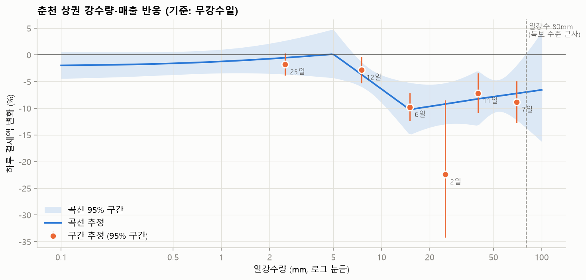

# 빅콘테스트 2026 — 춘천 호우 주제 분석 공유

> 작성일: 2026-10-17 · 대상: 팀원 전체 · 작성: 모델링 담당 · 저장소: <https://github.com/cite2denfert/Big_contest>
>
> 이전 공유 문서([progress_status.md](progress_status.md), 10/9)는 주제 확정 전 내용입니다. 이 문서가 최신입니다.

## TL;DR

- **주제(확정)**: 춘천 상권의 매출 피해는 **영업시간에 내리는 10mm 안팎의 비**에서 이미 시작됩니다. 그런데 지원 제도(호우특보, 재해 지원)는 **3시간 60mm 이상** 같은 강한 비를 기준으로 합니다. 그래서 기존 제도가 보지 못하는 손실이 생기고, 이를 **AI로 미리 예측해 선제 지원**하자는 주제입니다.
- **근거**
  - 비가 10mm를 넘는 날부터 매출이 7~10% 줄어듭니다. 그보다 비가 더 와도 감소 폭은 비슷하게 유지됩니다.
  - 매출을 줄이는 건 **영업시간(10~21시)에 오는 비**뿐입니다. 밤에 오는 비는 효과가 없습니다.
  - 순열 검정(p = 0.001)과 플라시보 검정을 통과했습니다.
- **특보와의 격차**: 2025 하반기 춘천에서 일강수 10mm 이상인 날은 26일이었습니다. 이 중 호우주의보 기준에 닿은 날은 **7/20 하루뿐**입니다.
- **피해 규모**: 2025 하반기 비 온 날 당일 손실은 약 **222억 원**입니다(90% 구간 170~271억). 평년 강수 빈도로 환산하면 연간 약 **313억 원**입니다.
- **모델**: 예측 모델(ML)이 "비가 안 왔다면 매출"을 계산하고, 회귀가 "비 오면 몇 % 줄지"를 맡는 **하이브리드**로 예상 피해액을 냅니다. 비 오는 날 도시 전체 매출 예측 오차는 8.9%(기상 정보 없음)에서 8.1%로 줄었습니다. 다만 **어느 업종군이 더 피해를 보는지 가려내는 정확도는 아직 약합니다.**
- **이번에 같이 정할 것**: ① 외부 데이터를 쓸지, 쓴다면 무엇을 쓸지(8장) ② 남은 작업 분담(9장)

---

## 1. 주제의 논리

```
[문제]  비 → 외출 감소 → 춘천 상권 매출 감소
[격차]  피해 시작점: 영업시간 비 약 10mm
        지원 기준:   호우특보 3시간 60mm / 12시간 110mm (주의보)
        → 두 기준 사이의 비가 일으키는 손실은 어떤 제도에도 잡히지 않음
[해결]  강수 예보 → 업종군별 피해 예측 → 기준을 넘는 날 선제 지원
```

- 춘천의 기존 제도(풍수해보험, 재해 융자)는 **물리적 피해(침수·파손)**를 전제로 합니다. 재해 융자는 재해확인증이 있어야 받을 수 있습니다.
- 팀원 조사로는 춘천에 AI 기반 예방 제도가 없습니다. 서울(AI 침수예측)과 해외 사례(NYC BPREP 등)는 비교·벤치마크로 씁니다.

## 2. 데이터와 전처리

| 항목 | 내용 |
|---|---|
| 카드 | 신한카드 데이터1(일×6시간대) 사용. 법인 결제와 비상권 업종 13개(세금·보험·통신·쇼핑몰 등)는 제외 |
| 단위 | 춘천 업종을 **업종군 12개**로 묶음(외식, 생활소매, 야외·레저, 숙박·여행 등) |
| 기상 | 기상청 춘천 ASOS(지점 101). 2025년 일·시간 자료, 평년 빈도용 2015~2024 일자료 |
| 통제 | 같은 주(주 고정효과), 요일, 공휴일·추석 연휴(10/3~10/9), 12/24·12/31 |
| 강남 | 비교용, 그리고 예측 모델 학습 데이터를 늘리는 용도로만 사용 |

## 3. 핵심 근거: 비가 얼마나, 언제 와야 피해가 생기나

결과: [outputs/chuncheon_rain_response/summary.md](../outputs/chuncheon_rain_response/summary.md)

### 3-1. 강수량별 매출 변화 (기준: 비 안 온 날)

| 일강수 | 일수 | 매출 변화 | 판정 |
|---|---:|---:|---|
| 0.1~5mm | 25 | −1.8% | 유의하지 않음 |
| 5~10mm | 12 | −2.8% | 약함 |
| **10~20mm** | 6 | **−9.8%** | 뚜렷함 |
| 20~30mm | 2 | −22.4% | 2일뿐이라 구간이 넓음(−34%~−9%) |
| 30~50mm | 11 | −7.2% | 뚜렷함 |
| 50mm 이상 | 7 | −8.9% | 뚜렷함 |



- **피해는 10mm 부근에서 시작하고, 그 뒤로는 −7~−10%로 거의 평탄합니다.** 곡선 추정으로는 10mm에서 −6.4%, 20mm에서 −9.7%, 50mm에서 −7.8%입니다.
- 이 결과가 주제의 핵심입니다. 비가 "많이" 오는 것보다 비가 "오는 것" 자체가 손님을 줄입니다. 그래서 강도를 기준으로 삼는 특보와 맞지 않습니다.

### 3-2. 언제 오는 비인가

| 항목 | 효과 | 판정 |
|---|---:|---|
| 영업시간(10~21시) 비 | −3.1% (강수량 약 2.7배당) | 유의 |
| 영업시간 외 비 | −0.3% | 효과 없음 |
| 같은 양일 때 고강도(시간당 15mm+) 추가 효과 | +3.0% | 효과 없음 |
| 같은 양일 때 장시간(8시간+) 추가 효과 | +1.0% | 효과 없음 |

- 6시간 단위로 쪼개 보면, 그 시간대에 0.1~2mm만 와도 그 시간대 매출이 −6.9% 줄어듭니다. 같은 날 **다른 시간대**에 온 비는 효과가 0입니다.
- 정리하면, 피해를 결정하는 건 **비의 세기가 아니라 영업시간과 겹치는지**입니다.

### 3-3. 우연이나 다른 요인 때문은 아닌가

| 검증 | 방법 | 결과 |
|---|---|---|
| 순열 검정 | 같은 달 안에서 비 온 날짜를 1,000번 무작위로 섞음 | 실제 효과 −8.7%는 무작위 분포(−2.6%~+2.1%) 밖. **p = 0.001** |
| 플라시보 | 오늘은 비가 안 왔고 내일 10mm 이상 오는 날, 오늘 매출 변화 | −1.6% (유의하지 않음) → 정상 |

- 참고: 단순히 "내일 비"만 보면 오늘 매출과 관련이 있는 것처럼 보입니다. 그런데 이는 비가 며칠 연달아 오기 때문입니다(내일 비 오는 날은 오늘도 비 오는 경우가 많음). 오늘 비가 안 온 날로 한정하면 효과가 사라집니다.

## 4. 특보 기준과의 격차

결과: [outputs/chuncheon_subdisaster/summary.md](../outputs/chuncheon_subdisaster/summary.md)

- 시간별 강수로 호우특보 기준(주의보: 3시간 60mm 또는 12시간 110mm)을 재계산했습니다.
- 2025 하반기 일강수 10mm 이상 26일 중 **주의보 수준은 7/20(3시간 81mm) 하루**, 경보 수준은 0일입니다.
- 일강수 66~71mm였던 8/6, 9/13도 3시간 최대는 46mm로 기준에 못 미쳤습니다.

> ⚠️ **주의**: "강수 손실의 97%가 특보 미달 비에서 발생"이라는 숫자도 계산했습니다. 하지만 특보 미달인 날이 훨씬 많으니 당연히 나오는 숫자입니다. **핵심 근거로 쓰지 말고**, 3장의 반응 곡선과 시간대 결과를 근거로 씁시다.

## 5. 피해 규모

| 항목 | 값 |
|---|---|
| 2025 하반기 비 온 날 당일 손실 (회귀) | **222억 원** (90% 구간 170~271억) |
| 같은 기간, 예측 모델 기준 | 82억 원 (보수적 추정) |
| 평년(2015~2024) 강수 빈도 기준 연간 기대 손실 | **약 313억 원** |
| 연간 기대 손실 중 10~30mm 비 비중 | 42% (가장 큼) |

- 두 방법의 추정치 차이가 큽니다. 발표에서는 **범위**로 제시하는 게 안전합니다.
- 업종군별 피해율(30mm 이상 날, 추정이 불안정한 값은 0 쪽으로 보수적으로 줄인 값): 야외·레저 36%, 패션·뷰티 12%, 주점·유흥 11%, 차량·교통 9%, 숙박·여행 9%, 외식 8%.
- 호우 뒤 5일까지의 회복을 보면, **야외·레저(누적 −35%)와 숙박·여행(누적 −47%)은 다음 날 이후에도 손실을 메우지 못합니다.** 생활소매는 다음 날 장보기 수요가 되살아나 손실을 메웁니다(누적 +3%, 1~5일 사이 반등은 유의). 다만 업종군별 회복 추정은 구간이 넓습니다.

## 6. 예측 모델 (모델링 파트)

결과: [outputs/chuncheon_model/summary.md](../outputs/chuncheon_model/summary.md)

### 구조

- **예측 대상**: 업종군별 일 매출. 정확히는 최근 28일 중 **비 안 온 평일**의 평균 대비 얼마나 높거나 낮은지를 예측합니다. 기준에 비 온 날을 섞으면 비가 잦은 시기에 기준이 낮아져 피해가 작게 잡히기 때문입니다.
- **입력**
  - 지난주·2주 전 매출, 최근 7일 평균
  - 요일, 공휴일
  - 강수: 양, 시간 최대, 강수 시간, 전날·전전날 비, 연속 강수일
  - 기온: 평년 대비 편차, 폭염 여부
- **모델**: LightGBM. 비가 많이 올수록 예측 매출이 늘어나지 않도록 단조 제약을 걸었습니다.
- **검증**: **시간 순 검증**입니다. 9~12월의 각 달을 그 이전 데이터만으로 학습해 예측했습니다. 미래를 모르는 실제 사용 조건과 같습니다.
- **피해 예측**: "비가 안 온다고 가정한 예측"에서 "실제 강수로 한 예측"을 뺀 값입니다. 운영할 때는 강수 예보를 넣어 계산합니다.

### 성능 (WAPE: 예측 오차율, 낮을수록 좋음)

| 비교 모델 | 전체 | 비 10mm+ 날 | 비 30mm+ 날 |
|---|---:|---:|---:|
| 지난주 같은 요일 그대로 | 16.8% | 27.0% | 25.3% |
| 기상 정보 없이 학습 | 13.8% | 20.9% | 19.4% |
| **강수 포함 (춘천+강남 학습)** | 13.8% | **19.8%** | **18.1%** |


- 강수를 넣으면 **비 오는 날 오차가 1.1~1.3%p 줄어듭니다.** 기상 정보 없는 모델이 비 오는 날 매출을 과대예측하던 편향도 −0.064에서 −0.028로 줄었습니다.
- 강남 데이터를 함께 학습한 모델과 춘천만 학습한 모델의 성능은 비슷합니다(비 10mm+ 날 19.8% vs 19.6%).

### 한계 (솔직하게)

- **업종군 간 피해 순위를 맞히는 정확도가 낮습니다** (순위 일치도가 지표·기간에 따라 0 부근에서 0.6까지 흔들림, 1이 완벽). 총 피해는 잡지만 "어느 업종이 더 큰지"는 잘 못 가립니다.
- 학습 기간이 6개월이고 비 오는 날이 26일뿐이라 생기는 한계입니다.
- 보완: 외부 데이터로 비 오는 날 사례를 늘립니다(8장).

### 예상 피해 규모: 하이브리드 모델

결과: [outputs/chuncheon_hybrid/summary.md](../outputs/chuncheon_hybrid/summary.md)

ML만으로 피해를 계산하면 비 오는 날이 적어서 피해를 작게 잡습니다. 그래서 역할을 나눴습니다.

```
예상 피해 = ML이 예측한 "비가 안 왔다면 매출" × 회귀로 추정한 강수 구간별·업종군별 피해율
```

검증은 시간 순 방식(9~12월)으로 했습니다. ML과 회귀 모두 시험 달 이전 자료로만 추정했습니다.

| 도시 전체 하루 매출 예측 오차 | 기상 정보 없음 | ML | **하이브리드** |
|---|---:|---:|---:|
| 비 10mm+ 날 | 8.9% | 8.6% | **8.1%** |
| 비 30mm+ 날 | 7.6% | 7.9% | **7.5%** |
| 비 안 온 날 | 5.9% | 5.8% | 5.5% |

- 피해 자체는 관측할 수 없습니다. 그래서 "비가 안 왔다면 매출 − 실제 매출"(실측 부족분)과 비교했습니다.
- 9~12월 비 10mm 이상 15일 합계

  | 구분 | 금액 |
  |---|---:|
  | 하이브리드 | **65억** (90% 구간 56~71억) |
  | ML | 57억 |
  | 실측 부족분 | 60~137억 |

  실측 부족분이 범위인 이유: 9월 중순~10월(추석 전후·가을 행락철)에는 비 안 온 날에도 실제 매출이 모델 기준보다 5~7% 높았습니다. 이전 달로 학습한 모델이 계절 상승을 따라가지 못한 것으로 보입니다. 이 편향을 더하면 위쪽 값(137억)이 됩니다. 다만 편향의 일부가 비 갠 날의 보복 소비라면 위쪽 값은 과대입니다.
- **해석**: 하이브리드와 ML 모두 실측 범위의 아래쪽에 있는 **보수적 추정**입니다. 발표에서는 "최소 이 정도"로 제시하는 것이 안전합니다.
- **지원 규모용 조견표** (평상일 매출 기준, 신한카드 개인 결제)

  | 강수 예보 | 하루 예상 피해 (90% 구간) |
  |---|---|
  | 10~30mm | 6.4억 (4.2~8.3억) |
  | 30mm+ | 6.5억 (4.7~8.1억) |
  | 0.1~10mm | 1.4억 |

- **업종군 구분은 여전히 약합니다.** 순위 일치도는 하이브리드 0.38, ML 0.60입니다. 다만 업종군 12개 × 15일로 계산한 값이라 기준을 조금만 바꿔도 크게 흔들립니다. 하이브리드는 야외·레저처럼 피해가 큰 업종의 크기를 더 크게 잡습니다(실측 15%, 하이브리드 26%, ML 7%). 그러나 숙박·여행, 교육처럼 실측으로는 피해가 없는 업종에도 피해를 매깁니다.

### 남은 모델링

- **모델 2: 피해 경보 분류기**. 내일 비 예보를 넣어 "업종군 매출이 X% 이상 줄어드는 날인가"를 예/아니오로 맞힙니다. 지원 발동 기준과 직결됩니다.
- 우선 지원 알고리즘의 **사후 검증(백테스트)**: 이 알고리즘이 실제로 피해가 컸던 날과 업종을 골랐는지 확인합니다.

## 7. 과제별 진행 상황

| 과제 | 상태 | 남은 일 |
|---|---|---|
| 1. 취약 상권 정의 | 🟡 | 주제 맞춤 정의 문장. 예: "영업시간 비에 매출이 X% 이상 줄고, 다음 날 회복하지 못하는 업종군" |
| 2. 피해규모 분석 | 🟢 거의 완료 | 발표용 범위 정리 |
| 3. 우선 지원 알고리즘 | 🟡 | 취약도 지수 1차 버전 있음. 주제(영업시간 비 기준)에 맞게 수정, 발동 기준 설정, 사후 검증 |
| 4. 대응·지원 방안 | 🔴 시작 전 | 예: 영업시간 강수 예보 기반 자동 발동형 지원, 특보 미달 비 피해 보전 |
| 예측·분류 모델 | 🟡 | 모델 1, 하이브리드(예상 피해 규모) 완료. 모델 2(경보 분류기) 남음 |

## 8. 외부 데이터 활용 — 💬 팀 논의 필요

**왜 필요한가**: 2025 하반기 데이터만으로는 비 오는 날 사례가 26일, 특보 수준 날이 1일입니다. 그래서 신뢰구간이 넓고 업종군 구분이 약합니다.

**공모전 규칙**: 외부 데이터는 **무료·공개 자료만** 쓸 수 있습니다. **출처와 수집 방법을 기록**하고 **원본 파일을 제출**해야 합니다.

| 후보 | 출처 | 사용 가능성 | 기대 효과 | 확인할 점 |
|---|---|---|---|---|
| ① 기상특보 발효 이력 (호우, 2015~2025) | 기상청 기상자료개방포털 | 🟢 로그인 후 다운로드 | 높음. 시간 강수로 재계산한 특보 수준이 아니라 **실제로 발효된 특보**와 비교 가능 | 강원 영서·춘천 단위로 받을 수 있는지 |
| ② 춘천 10년치 시간별 강수 (2015~2025) | 기상청 ASOS (지금 쓰는 출처) | 🟢 기존 스크립트로 바로 수집 | 높음. "해마다 특보 미달 영업시간 비가 며칠인가"를 10년 평균으로 제시 | 없음 (1~2시간 소요) |
| ③ 지역별 방문자 수 (일 단위, 기초지자체) | 한국관광공사 빅데이터 (공공데이터포털 15101972) | 🟡 무료 API 신청 필요 | 높음. **매출 6개월보다 긴 기간**에서 "비 → 외부 방문객 감소"를 확인. 숙박·여행·야외 업종의 근거 보강 | 수록 시작 연도 미확인. 방문자는 관광객과 다름(통신 기반, 장기 체류도 매일 집계) |
| ④ 고속도로 교통량 | 한국도로공사 | 🔴 | — | 춘천 구간 공개 여부 불분명 |
| ⑤ 춘천 버스 이용량 | — | 🔴 | — | 비공개 |
| ⑥ 서울 지하철 승하차 | 서울 열린데이터광장 | 강남 비교용만 | 낮음 | 주제가 춘천이라 우선순위 낮음 |

**제안**: ②는 바로 진행하고, ①은 함께 진행, ③은 팀이 동의하면 추가.

**논의할 질문**
1. 외부 데이터를 쓸 것인가? 안 쓰면 "6개월 데이터의 한계"를 발표에서 어떻게 설명할지 정해야 합니다.
2. ③ 방문자 수를 쓴다면 어디에 쓸 것인가?
   - (a) 비 효과를 보여주는 보조 근거로만 쓸지
   - (b) 예측 모델의 입력 변수로 쓸지 (운영 시점에 그날 방문자 수를 미리 알 수 없다는 문제가 있음)
3. 수집 분담: ①은 기상청 로그인, ③은 공공데이터포털 API 키 신청이 필요합니다. 누가 맡을지 정해야 합니다.
   - API 키는 채팅이나 저장소에 올리지 말고 각자 `.env` 파일에 보관합니다(`.gitignore` 처리됨).
4. 외부 데이터 출처·수집 방법 기록과 원본 제출 정리는 누가 맡을지.

## 9. 다음 단계와 분담 제안

| 순서 | 할 일 | 담당(제안) |
|---|---|---|
| 1 | 외부 데이터 결정 및 수집 (8장) | 팀 결정 → 수집 분담 |
| 2 | 모델 2(피해 경보 분류기) | 모델링 |
| 3 | 우선 지원 알고리즘을 주제에 맞게 수정, 사후 검증 | 모델링 + 1명 |
| 4 | 취약 상권 정의 문장, 대응·지원 방안 설계 (제도 조사 결과 연결) | 조사 담당 |
| 5 | 보고서·발표 자료, LLM 사용 설명 문서 | 전원 |

## 부록: 재현 방법

- 코드와 결과는 저장소에 있습니다. 공모전 제공 원본(카드·유동인구)과 기상 원자료는 `data/` 폴더에 두며 저장소에는 올리지 않습니다.
- 실행 예시 (uv 설치 필요):

```bash
uv run --no-project --with pandas --with matplotlib --with tabulate --with statsmodels \
  --with scipy --with lightgbm --with scikit-learn python -X utf8 scripts/chuncheon_rain_response.py
```

| 스크립트 | 내용 | 결과 폴더 |
|---|---|---|
| `scripts/chuncheon_data.py` | 춘천 패널 구성 (공통 모듈) | — |
| `scripts/chuncheon_rain_response.py` | 반응 곡선, 시간대, 순열·플라시보 검정 | `outputs/chuncheon_rain_response` |
| `scripts/chuncheon_subdisaster.py` | 특보 수준 판정, 피해 규모 | `outputs/chuncheon_subdisaster` |
| `scripts/chuncheon_model.py` | 예측 모델, 시간 순 검증, 충격-회복 | `outputs/chuncheon_model` |
| `scripts/chuncheon_hybrid.py` | 예상 피해 규모 하이브리드, 시간 순 검증, 조견표 | `outputs/chuncheon_hybrid` |
| `scripts/vulnerability_index.py` | 취약도 지수 (1차 버전) | `outputs/vulnerability` |
