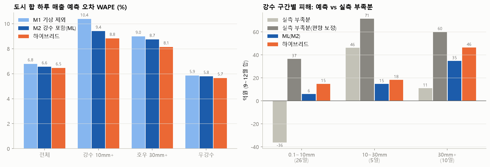

# 춘천 예상 피해 규모 — 하이브리드 모델

방법은 `scripts/chuncheon_hybrid.py` 상단 주석 참고. 기준 매출 = ML(M2, 강수 0 반사실), 강수 피해율 = 회귀(업종군별, 0 중심 축소). 시험 기간 9~12월, 모든 추정은 시험 달 이전 자료로만.

## 1. 비 오는 날 매출 예측 정확도 (시간 순 검증)

피해 자체는 관측되지 않으므로, '피해를 반영한 예상 매출'이 실제 매출과 얼마나 맞는지로 검증한다.

**WAPE** (낮을수록 좋음)

|                        | M1 기상 제외   | M2 강수 포함(ML)   | 하이브리드   | 하이브리드(기준=M1)   |
|:-----------------------|:-----------|:---------------|:--------|:---------------|
| ('업종군×일', '전체')        | 13.7%      | 13.8%          | 13.8%   | 13.7%          |
| ('업종군×일', '강수 10mm+')  | 21.4%      | 20.2%          | 19.9%   | 20.5%          |
| ('업종군×일', '호우 30mm+')  | 20.1%      | 18.7%          | 18.1%   | 18.9%          |
| ('업종군×일', '무강수')       | 11.6%      | 11.8%          | 11.7%   | 11.6%          |
| ('도시 합×일', '전체')       | 6.8%       | 6.6%           | 6.5%    | 6.7%           |
| ('도시 합×일', '강수 10mm+') | 10.4%      | 9.4%           | 8.8%    | 9.6%           |
| ('도시 합×일', '호우 30mm+') | 9.0%       | 8.7%           | 8.1%    | 9.2%           |
| ('도시 합×일', '무강수')      | 5.9%       | 5.8%           | 5.7%    | 5.9%           |

**편향** (평균 log(실제/예측). 음수 = 과대예측, 즉 피해를 작게 봄)

|                        |   M1 기상 제외 |   M2 강수 포함(ML) |   하이브리드 |   하이브리드(기준=M1) |
|:-----------------------|-----------:|---------------:|--------:|---------------:|
| ('업종군×일', '전체')        |      0.003 |          0.002 |   0.009 |          0.015 |
| ('업종군×일', '강수 10mm+')  |     -0.048 |         -0.019 |   0.023 |          0.034 |
| ('업종군×일', '호우 30mm+')  |      0.056 |          0.086 |   0.13  |          0.141 |
| ('업종군×일', '무강수')       |      0.02  |          0.013 |   0.014 |          0.02  |
| ('도시 합×일', '전체')       |      0.019 |          0.016 |   0.019 |          0.027 |
| ('도시 합×일', '강수 10mm+') |     -0.045 |         -0.011 |   0.001 |          0.007 |
| ('도시 합×일', '호우 30mm+') |     -0.009 |          0.027 |   0.042 |          0.047 |
| ('도시 합×일', '무강수')      |      0.031 |          0.022 |   0.022 |          0.031 |

## 2. 예상 피해 vs 실측 부족분 (시험 기간 9~12월, 도시 합)

실측 부족분 = 기준 매출(ML, 강수 0) − 실제 매출. 하루하루는 잡음이 커서 합계로 비교한다. 무강수일에도 실제 매출이 기준 매출보다 평균 +0.022(log) 높다. 기준 매출이 최근 28일 평균에서 출발해 비가 잦았던 달에는 앞선 비 피해가 기준에 섞여 낮게 잡히기 때문이다(월별 무강수일 편향: 9월 +0.048, 10월 +0.074, 11월 -0.023, 12월 +0.015). '보정'은 이 편향을 월별로 더한 값으로, 실제 피해는 두 값 사이에 있다고 본다.

| 구간       |   일수 |   실측 부족분(억) |   실측 부족분 보정(억) |   하이브리드(억) | 90% 구간    |   ML(M2)(억) |   하루 평균 하이브리드(억) | 실측 부족률   | 하이브리드 피해율   | ML 피해율   |
|:---------|-----:|------------:|---------------:|-----------:|:----------|------------:|-----------------:|:---------|:------------|:---------|
| 0.1~10mm |   26 |       -36.2 |           36.5 |       14.9 | 7.9~20.9  |         6   |              0.6 | -1.7%    | 0.7%        | 0.3%     |
| 10~30mm  |    5 |        46.2 |           71.5 |       18.3 | 13.5~22.5 |        14.8 |              3.7 | 11.1%    | 4.4%        | 3.6%     |
| 30mm+    |   10 |        11   |           60.1 |       46.4 | 39.6~51.8 |        34.7 |              4.6 | 1.3%     | 5.5%        | 4.1%     |
| 10mm+ 합  |   15 |        57.1 |          131.6 |       64.7 | 56.0~71.3 |        49.5 |              4.3 | 4.5%     | 5.1%        | 3.9%     |

**업종군별 (강수 10mm+ 날)**

| group    |   일수 | 실측 부족률   | 하이브리드 피해율   | ML 피해율   |
|:---------|-----:|:---------|:------------|:---------|
| 야외·레저    |   15 | +16.3%   | +26.2%      | +5.2%    |
| 차량·교통    |   15 | +10.0%   | +9.8%       | +4.9%    |
| 생활소매     |   15 | +9.4%    | +1.0%       | +3.5%    |
| 의료       |   15 | +4.3%    | +6.9%       | +4.7%    |
| 패션·뷰티소매  |   15 | +3.9%    | +12.6%      | +4.3%    |
| 외식       |   15 | +2.4%    | +2.4%       | +3.7%    |
| 주점·유흥    |   15 | +0.5%    | +9.0%       | +2.8%    |
| 숙박·여행    |   15 | -6.0%    | +6.4%       | +4.4%    |
| 문화·취미    |   15 | -8.8%    | -0.2%       | +3.7%    |
| 가정·내구재   |   15 | -22.0%   | +7.8%       | +5.5%    |
| 미용·생활서비스 |   15 | -23.3%   | +2.6%       | +3.8%    |
| 교육       |   15 | -30.8%   | +8.4%       | -1.6%    |

- 업종군 순위 일치도(스피어만, 1 = 완벽): 하이브리드 **0.35**, ML(M2) 0.38

## 3. 조견표: 강수 예보 구간별 하루 예상 피해 (전 기간 회귀, 평상일 매출 기준)

지원 규모 산정용. 신한카드 개인 결제·상권 업종 기준이라 춘천 전체 상권으로 확대하려면 카드사 점유율 보정이 필요하다.

| 구간       |   하루 피해(억) |   90% 하한 |   90% 상한 | 평상일 매출 대비   |
|:---------|-----------:|---------:|---------:|:------------|
| 0.1~10mm |       1.41 |     0.4  |     2.39 | 1.6%        |
| 10~30mm  |       6.42 |     4.18 |     8.29 | 7.5%        |
| 30mm+    |       6.45 |     4.68 |     8.1  | 7.5%        |
| 호우 다음날   |       0.27 |    -1.04 |     1.48 | 0.3%        |

**업종군별 피해율** (양수 = 손실)

| group    | 0.1~10mm   | 10~30mm   | 30mm+   | 호우 다음날   |
|:---------|:-----------|:----------|:--------|:---------|
| 야외·레저    | +4.4%      | +20.2%    | +36.9%  | +0.8%    |
| 패션·뷰티소매  | +5.3%      | +16.1%    | +11.3%  | -0.3%    |
| 차량·교통    | +2.4%      | +11.3%    | +9.0%   | -2.2%    |
| 교육       | -1.6%      | +10.6%    | -4.6%   | -1.0%    |
| 가정·내구재   | +0.1%      | +8.5%     | +7.7%   | +2.0%    |
| 의료       | -0.9%      | +6.7%     | +4.8%   | +0.2%    |
| 외식       | +3.4%      | +6.2%     | +8.0%   | +2.2%    |
| 숙박·여행    | -0.2%      | +5.7%     | +11.2%  | +3.1%    |
| 미용·생활서비스 | +1.4%      | +5.5%     | -1.9%   | -3.5%    |
| 생활소매     | +0.6%      | +4.9%     | +4.9%   | +0.1%    |
| 문화·취미    | +3.8%      | +4.1%     | +5.9%   | +0.4%    |
| 주점·유흥    | +2.2%      | +1.7%     | +10.0%  | +0.8%    |

