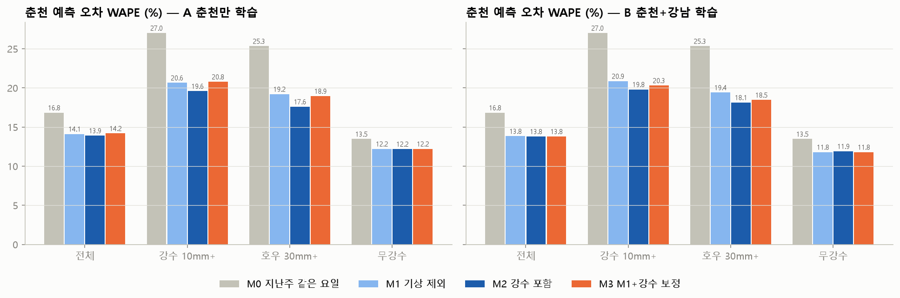
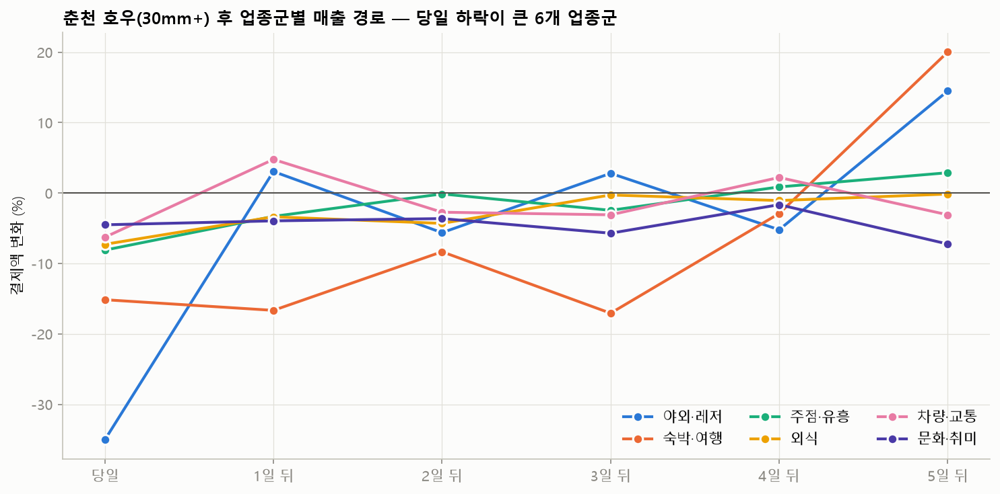

# 춘천 업종군 강수 피해 예측 모델

방법은 `scripts/chuncheon_model.py` 상단 주석 참고.

- 춘천 업종군 12개, 학습 가능 행 2,100행 (2025-07-08~12-31)
- 춘천 월별 강수일: 7월 10mm+ 7일·30mm+ 4일, 8월 10mm+ 4일·30mm+ 4일, 9월 10mm+ 10일·30mm+ 7일, 10월 10mm+ 5일·30mm+ 3일, 11월 10mm+ 0일·30mm+ 0일, 12월 10mm+ 0일·30mm+ 0일

## 1. 시간 순 검증 성능 (9~12월 각 달을 그 이전 기간으로 학습해 예측)

**WAPE** (낮을수록 좋음)

|                            | M0 지난주 같은 요일   | M1 기상 제외   | M2 강수 포함   | M3 M1+강수 보정   |
|:---------------------------|:---------------|:-----------|:-----------|:--------------|
| ('A 춘천만 학습', '전체')         | 16.8%          | 14.1%      | 13.9%      | 14.2%         |
| ('A 춘천만 학습', '강수 10mm+')   | 27.0%          | 20.6%      | 19.6%      | 20.8%         |
| ('A 춘천만 학습', '호우 30mm+')   | 25.3%          | 19.2%      | 17.6%      | 18.9%         |
| ('A 춘천만 학습', '무강수')        | 13.5%          | 12.2%      | 12.2%      | 12.2%         |
| ('B 춘천+강남 학습', '전체')       | 16.8%          | 13.8%      | 13.8%      | 13.8%         |
| ('B 춘천+강남 학습', '강수 10mm+') | 27.0%          | 20.9%      | 19.8%      | 20.3%         |
| ('B 춘천+강남 학습', '호우 30mm+') | 25.3%          | 19.4%      | 18.1%      | 18.5%         |
| ('B 춘천+강남 학습', '무강수')      | 13.5%          | 11.8%      | 11.9%      | 11.8%         |

**편향** (실제−예측 평균 log. 음수 = 과대예측 (비 효과를 놓치면 강수일에 음수))

|                            |   M0 지난주 같은 요일 |   M1 기상 제외 |   M2 강수 포함 |   M3 M1+강수 보정 |
|:---------------------------|---------------:|-----------:|-----------:|--------------:|
| ('A 춘천만 학습', '전체')         |          0.003 |     -0.008 |     -0.01  |        -0.003 |
| ('A 춘천만 학습', '강수 10mm+')   |         -0.058 |     -0.076 |     -0.04  |        -0.052 |
| ('A 춘천만 학습', '호우 30mm+')   |          0.054 |      0.015 |      0.054 |         0.038 |
| ('A 춘천만 학습', '무강수')        |          0.019 |      0.013 |      0.004 |         0.013 |
| ('B 춘천+강남 학습', '전체')       |          0.003 |     -0.005 |     -0.008 |         0.001 |
| ('B 춘천+강남 학습', '강수 10mm+') |         -0.058 |     -0.064 |     -0.028 |        -0.029 |
| ('B 춘천+강남 학습', '호우 30mm+') |          0.054 |      0.034 |      0.069 |         0.071 |
| ('B 춘천+강남 학습', '무강수')      |          0.019 |      0.013 |      0.004 |         0.013 |

## 2. 예측 피해 (시험 기간 9~12월, A 춘천만 학습의 M2)

예측 피해 = '강수 변수를 0으로 바꾼 예측' − '실제 예보(관측) 강수로 한 예측'. 시험 기간에 학습하지 않은 날에 대한 예측이라 실제 예보 활용과 같은 조건.

강수 10mm+ 일, 업종군별 (실제편차 = 실제 매출이 기상 제외 예측보다 얼마나 낮았나 → 예측손실률과 비교):

| group    |   일수 | 예측손실률   |   예측손실_백만 | 실제편차_M1대비   |
|:---------|-----:|:--------|----------:|:------------|
| 생활소매     |   15 | 3.8%    |    1384.3 | -9.0%       |
| 외식       |   15 | 4.1%    |    1221.9 | -4.6%       |
| 차량·교통    |   15 | 7.0%    |    1044.5 | -9.9%       |
| 야외·레저    |   15 | 6.8%    |     451   | -16.3%      |
| 패션·뷰티소매  |   15 | 5.9%    |     150.1 | -9.4%       |
| 가정·내구재   |   15 | 7.0%    |     146.8 | -0.8%       |
| 미용·생활서비스 |   15 | 3.8%    |     106   | -4.1%       |
| 문화·취미    |   15 | 3.3%    |      89.9 | +3.3%       |
| 숙박·여행    |   15 | 3.6%    |      18.7 | +1.4%       |
| 의료       |   15 | 0.5%    |       7.5 | -18.2%      |
| 주점·유흥    |   15 | 0.6%    |       4.4 | +0.5%       |
| 교육       |   15 | -2.9%   |    -115.3 | -17.0%      |

- 업종군 순위 일치도(예측 손실률 vs 실제 편차, 스피어만): **-0.02** (1에 가까울수록 피해가 큰 업종군을 맞힘)

## 3. 충격-회복 곡선 (호우 30mm+ 당일~5일 뒤, 춘천 업종군)

보충률 = −(1~5일 뒤 효과 합) ÷ 당일 효과. 1이면 손실을 모두 메움, 0이면 못 메움, 음수면 손실이 이어짐.

| group    | 당일     |   1~5일 합 |   1~5일 합_se |   누적(0~5일) |   누적_se |     보충률 | 유의(1~5일)   |
|:---------|:-------|---------:|------------:|-----------:|--------:|--------:|:-----------|
| 외식       | -7.3%  |   -0.093 |       0.052 |     -0.169 |   0.071 |  -1.232 | 아니오        |
| 주점·유흥    | -8.1%  |   -0.023 |       0.121 |     -0.107 |   0.138 |  -0.268 | 아니오        |
| 생활소매     | -3.3%  |    0.065 |       0.026 |      0.031 |   0.035 |   1.927 | 예          |
| 패션·뷰티소매  | -3.2%  |   -0.075 |       0.121 |     -0.107 |   0.134 |  -2.28  | 아니오        |
| 가정·내구재   | +1.5%  |    0.314 |       0.211 |      0.328 |   0.274 | nan     | 아니오        |
| 문화·취미    | -4.5%  |   -0.228 |       0.099 |     -0.274 |   0.112 |  -4.937 | 예          |
| 야외·레저    | -35.0% |    0.082 |       0.14  |     -0.35  |   0.136 |   0.19  | 아니오        |
| 숙박·여행    | -15.1% |   -0.303 |       0.185 |     -0.467 |   0.218 |  -1.846 | 아니오        |
| 의료       | -1.3%  |   -0.14  |       0.087 |     -0.153 |   0.119 | nan     | 아니오        |
| 미용·생활서비스 | +5.2%  |   -0.03  |       0.135 |      0.021 |   0.184 | nan     | 아니오        |
| 교육       | +25.3% |    0.427 |       0.188 |      0.653 |   0.304 | nan     | 예          |
| 차량·교통    | -6.3%  |   -0.022 |       0.04  |     -0.087 |   0.044 |  -0.336 | 아니오        |

