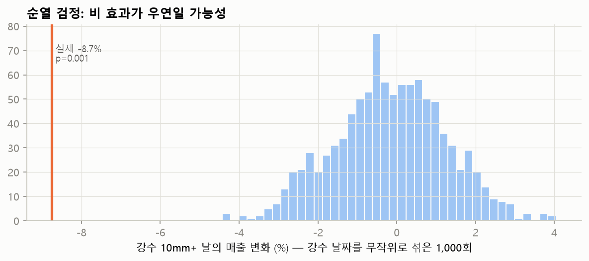

# 춘천 강수량-매출 반응 곡선과 비의 성격, 타당성 검증

방법은 `scripts/chuncheon_rain_response.py` 상단 주석 참고. 대상: 춘천 상권 업종 개인 결제 일 합계.

## 1. 강수량 구간별 하루 매출 변화 (기준: 무강수일)

| 구간(mm)   |   일수 | 변화율    | 하한     | 상한    |     p | 패널 변화율   |   패널 p |
|:---------|-----:|:-------|:-------|:------|------:|:---------|-------:|
| 0.1~5    |   25 | -1.8%  | -3.8%  | +0.3% | 0.093 | -0.5%    |  0.772 |
| 5~10     |   12 | -2.8%  | -5.3%  | -0.3% | 0.026 | -6.6%    |  0.001 |
| 10~20    |    6 | -9.8%  | -12.4% | -7.1% | 0     | -16.2%   |  0     |
| 20~30    |    2 | -22.4% | -34.2% | -8.5% | 0.003 | -36.1%   |  0.007 |
| 30~50    |   11 | -7.2%  | -10.9% | -3.4% | 0     | -8.5%    |  0     |
| 50+      |    7 | -8.9%  | -12.7% | -4.9% | 0     | -14.7%   |  0     |

'패널'은 업종군 12개를 한 모형에 넣은 강건성 추정(업종군·주·업종군별 요일 효과 통제, 업종군 평균 효과).

**곡선 추정** (강수 여부 + log(1+mm) 구간 직선, 꺾임점 5·15·40mm):

|   강수량(mm) | 변화율   | 95% 구간          |
|----------:|:------|:----------------|
|         1 | -1.2% | [-3.4%, +1.0%]  |
|         5 | +0.1% | [-4.3%, +4.7%]  |
|        10 | -6.4% | [-9.0%, -3.8%]  |
|        20 | -9.7% | [-13.6%, -5.5%] |
|        30 | -8.8% | [-12.9%, -4.6%] |
|        50 | -7.8% | [-10.9%, -4.7%] |
|        80 | -7.0% | [-13.7%, +0.3%] |

## 2. 비의 성격: 시간대·강도·지속시간

**영업시간(10~21시) 비 vs 영업시간 외 비** — log(1+mm) 1 증가(약 2.7배)당 변화:

| 항목        | 변화율   | 95% 구간         |     p |
|:----------|:------|:---------------|------:|
| 영업시간 강수   | -3.1% | [-4.4%, -1.8%] | 0     |
| 영업시간 외 강수 | -0.3% | [-1.1%, +0.6%] | 0.518 |
| 강수 여부     | -0.3% | [-2.7%, +2.1%] | 0.793 |

**같은 강수량 구간 안에서 강도·지속시간의 추가 효과** (강수 5mm+ 날 대상, 강수량 구간 통제):

| 항목            |   해당 일수 | 추가 변화율   | 95% 구간         |     p |
|:--------------|--------:|:---------|:---------------|------:|
| 고강도(시간 15mm+) |       9 | +3.0%    | [-3.2%, +9.5%] | 0.358 |
| 장시간(8시간+)     |      26 | +1.0%    | [-3.6%, +5.7%] | 0.686 |

**6시간대 모형** (06~11·12~17·18~23시, 552개 시간대 관측, 해당 시간대 강수 구간, 기준 0mm):

| 시간대 강수(mm/6h)            | 관측 수   | 변화율    | 95% 구간           |     p |
|:-------------------------|:-------|:-------|:-----------------|------:|
| 0.1~2                    | 38     | -6.9%  | [-9.7%, -4.1%]   | 0     |
| 2~5                      | 16     | -9.7%  | [-14.7%, -4.4%]  | 0     |
| 5~10                     | 18     | -8.1%  | [-12.9%, -3.1%]  | 0.002 |
| 10+                      | 24     | -14.2% | [-17.3%, -11.0%] | 0     |
| 같은 날 다른 시간대 강수 log(1+mm) | -      | -0.0%  | [-0.9%, +0.8%]   | 0.941 |

## 3. 타당성 검증

**플라시보 — 내일의 비가 오늘 매출에 미치는 효과** (0에 가까워야 정상):

| 내일 강수 구간   | 오늘 매출 변화   |     p | 참고: 오늘 강수 효과   |
|:-----------|:-----------|------:|:---------------|
| 0.1~5      | -2.3%      | 0.018 | -1.1%          |
| 5~10       | -1.6%      | 0.125 | -3.9%          |
| 10~20      | -8.3%      | 0.001 | -11.4%         |
| 20~30      | -2.5%      | 0.128 | -22.8%         |
| 30~50      | -3.9%      | 0.001 | -8.2%          |
| 50+        | +2.0%      | 0.043 | -9.7%          |

**플라시보 세분화** — 오늘 비가 오지 않았는데도 앞으로의 비가 오늘 매출과 관련되는지:

| 조건                   |   해당 일수 | 오늘 매출 변화   | 95% 구간         |     p |
|:---------------------|--------:|:-----------|:---------------|------:|
| 내일 10mm+ & 오늘 무강수    |       8 | -1.6%      | [-4.7%, +1.6%] | 0.325 |
| 내일 10mm+ & 오늘 강수     |      18 | -3.9%      | [-6.7%, -0.9%] | 0.01  |
| 모레 10mm+ & 오늘·내일 무강수 |       5 | -0.3%      | [-2.6%, +2.0%] | 0.792 |

**순열 검정** — 강수 10mm+ 날의 효과: 관측 -8.7%, 같은 달 안에서 강수 날짜를 1,000번 섞었을 때 이보다 크거나 같은 감소가 나온 비율 **p = 0.001** (무작위 분포 5~95%: -2.6% ~ +2.1%)

