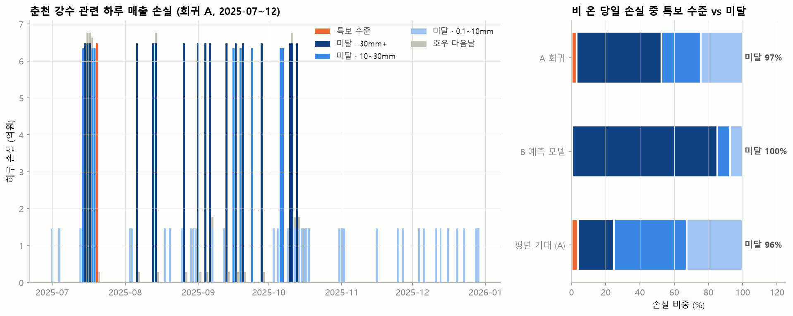

# 재해 기준에 못 미치는 비의 매출 손실 — 춘천

방법은 `scripts/chuncheon_subdisaster.py` 상단 주석 참고.

## 1. 특보 수준 판정 (2025-07~12, 춘천 ASOS 시간 강수)

기준: 호우주의보 = 3시간 60mm+ 또는 12시간 110mm+, 호우경보 = 3시간 90mm+ 또는 12시간 180mm+

일강수 10mm+ 날 26일 중 주의보 수준 **1일**, 경보 수준 0일

| date        |   일강수 |   최대1시간 |   최대3시간 |   최대12시간 | 주의보수준   | 경보수준   |
|:------------|------:|--------:|--------:|---------:|:--------|:-------|
| 07-20 (Sun) |  94.7 |    44.4 |    81.2 |    102.6 | True    | False  |
| 08-06 (Wed) |  70.9 |    25.6 |    45.7 |     70.9 | False   | False  |
| 09-13 (Sat) |  66.4 |    17.4 |    46.1 |     74   | False   | False  |
| 08-13 (Wed) |  65.1 |    12   |    24.1 |     59.2 | False   | False  |
| 09-17 (Wed) |  60.8 |    21.9 |    42.2 |     60.8 | False   | False  |
| 07-16 (Wed) |  55.2 |    20.9 |    38.3 |     50.8 | False   | False  |
| 09-01 (Mon) |  54.4 |    25.5 |    42.7 |     49.1 | False   | False  |
| 08-26 (Tue) |  46.2 |    27.3 |    29.1 |     46.2 | False   | False  |
| 09-06 (Sat) |  45.3 |    26.5 |    35.3 |     44.5 | False   | False  |
| 07-17 (Thu) |  42.1 |     9.1 |    35.4 |     64.9 | False   | False  |
| 08-14 (Thu) |  41.6 |    13.7 |    24.9 |     47.4 | False   | False  |
| 09-20 (Sat) |  41   |     9.8 |    24.7 |     47.4 | False   | False  |
| 10-10 (Fri) |  34.5 |     2.6 |     5.6 |     19.6 | False   | False  |
| 10-11 (Sat) |  33.3 |     5.4 |    13.1 |     31.1 | False   | False  |
| 10-13 (Mon) |  31.4 |     5.5 |    13.9 |     23.5 | False   | False  |
| 09-28 (Sun) |  30.9 |     9.4 |    18.5 |     30.9 | False   | False  |
| 07-15 (Tue) |  30.5 |    18.6 |    21.8 |     27.2 | False   | False  |
| 09-04 (Thu) |  30   |     7.8 |    19.7 |     30   | False   | False  |
| 10-06 (Mon) |  25.4 |     4.7 |    12.5 |     20.4 | False   | False  |
| 07-19 (Sat) |  23   |     5.6 |     8.8 |     16   | False   | False  |
| 07-18 (Fri) |  18.6 |     8.6 |    13.3 |     14.9 | False   | False  |
| 07-14 (Mon) |  18.5 |     4   |     7.3 |     12.6 | False   | False  |
| 09-16 (Tue) |  14.6 |    13.6 |    14.2 |     14.6 | False   | False  |
| 09-24 (Wed) |  12.7 |     6.5 |    10.9 |     12.7 | False   | False  |
| 09-19 (Fri) |  11.5 |     2.8 |     3.6 |      8.6 | False   | False  |
| 10-07 (Tue) |  10.6 |     4.9 |     7.1 |     27.8 | False   | False  |

## 2. 2025 하반기 강수 관련 매출 손실, 특보 수준 vs 미달

신한카드 개인 결제·상권 업종 기준. '호우 다음날'은 30mm+ 비 다음 날의 추가 효과.

| 구분            | 방법      |   일수 |   손실합(억) | 당일 손실 중 비중   |
|:--------------|:--------|-----:|---------:|:-------------|
| 특보 수준         | A 회귀    |    1 |      6.5 | 2.9%         |
| 미달 · 30mm+    | A 회귀    |   17 |    110.1 | 49.7%        |
| 미달 · 10~30mm  | A 회귀    |    8 |     50.8 | 22.9%        |
| 미달 · 0.1~10mm | A 회귀    |   37 |     54.4 | 24.5%        |
| 호우 다음날        | A 회귀    |   18 |      5.3 | -            |
| 특보 수준         | B 예측 모델 |    1 |      0.3 | 0.3%         |
| 미달 · 30mm+    | B 예측 모델 |   17 |     98.9 | 84.9%        |
| 미달 · 10~30mm  | B 예측 모델 |    8 |      8.6 | 7.3%         |
| 미달 · 0.1~10mm | B 예측 모델 |   35 |      8.7 | 7.5%         |
| 호우 다음날        | B 예측 모델 |   10 |    -34.6 | -            |

- **특보 기준에 못 미치는 비의 손실 비중**: A 회귀 **97%** (90% 구간 96%~98%), B 예측 모델 **100%**
- 비중은 비 온 당일 손실 기준. '호우 다음날'은 별도 효과로, A는 소폭 추가 손실, B는 반등(음수)으로 추정되어 방법 간 차이가 큼.
- 당일 손실 총액: A 222억 (90% 구간 170~271억), B 82억

## 3. 평년(2015~2024) 기준 연간 기대 손실 — 회귀(A)

30mm+ 구간은 특보 수준과 미달의 하루 손실률을 같게 둔 가정 (특보 수준 사례가 1일뿐이라 따로 추정 불가).

|                   |   연평균 일수 |   하루 손실(억) |   연간 기대 손실(억) | 당일 손실 중 비중   |
|:------------------|---------:|-----------:|--------------:|:-------------|
| 특보 수준(일 80mm+ 근사) |      1.8 |       6.48 |         11.66 | 3.7%         |
| 미달 · 30mm+        |     10.2 |       6.48 |         66.07 | 21.1%        |
| 미달 · 10~30mm      |     20.9 |       6.34 |        132.6  | 42.4%        |
| 미달 · 0.1~10mm     |     69.6 |       1.47 |        102.3  | 32.7%        |
| 호우 다음날            |     12   |       0.29 |          3.52 | -            |

- 평년 기준으로도 손실의 **96%**가 특보 수준에 못 미치는 비에서 발생 (비 온 당일 연간 기대 손실 313억 중 301억)

## 4. 업종군별 하루 손실률 (축소 후, A)

| group    | 0.1~10mm   | 10~30mm   | 30mm+   | 호우 다음날   |
|:---------|:-----------|:----------|:--------|:---------|
| 야외·레저    | +4.7%      | +19.4%    | +36.4%  | +0.7%    |
| 패션·뷰티소매  | +4.5%      | +16.1%    | +11.7%  | -0.4%    |
| 차량·교통    | +2.8%      | +11.3%    | +9.0%   | -1.9%    |
| 교육       | -1.5%      | +10.5%    | -4.0%   | -0.8%    |
| 가정·내구재   | +0.4%      | +8.1%     | +7.4%   | +1.7%    |
| 의료       | -0.9%      | +6.9%     | +5.2%   | +0.2%    |
| 외식       | +3.3%      | +6.2%     | +8.0%   | +1.9%    |
| 미용·생활서비스 | +1.2%      | +5.5%     | -1.7%   | -2.9%    |
| 생활소매     | +0.7%      | +4.8%     | +4.8%   | +0.3%    |
| 문화·취미    | +4.1%      | +4.0%     | +6.1%   | +0.4%    |
| 숙박·여행    | +0.8%      | +3.7%     | +8.7%   | +2.3%    |
| 주점·유흥    | +1.8%      | +2.5%     | +10.5%  | +0.8%    |

양수 = 손실, 음수 = 증가.

